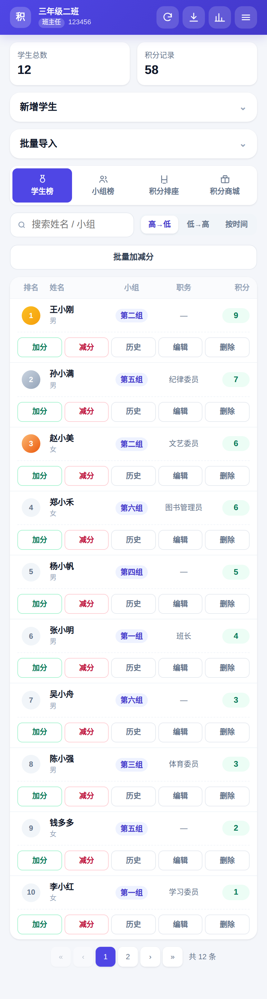
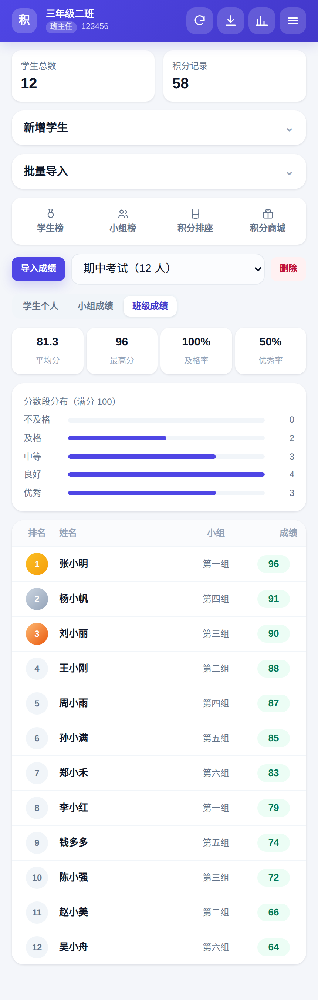
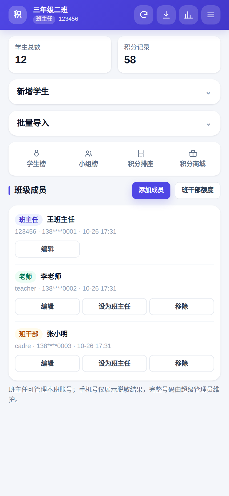
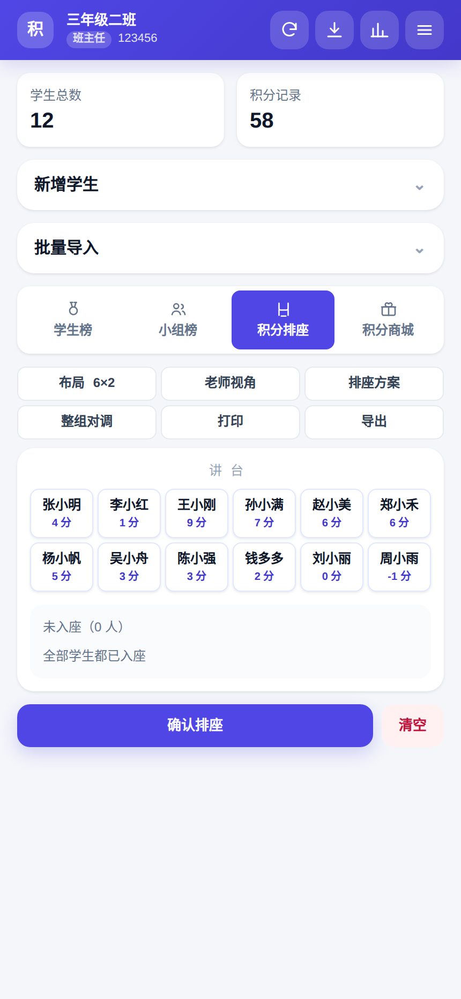
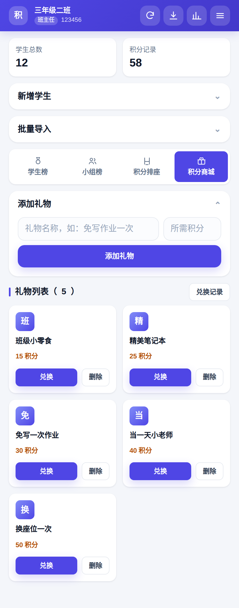
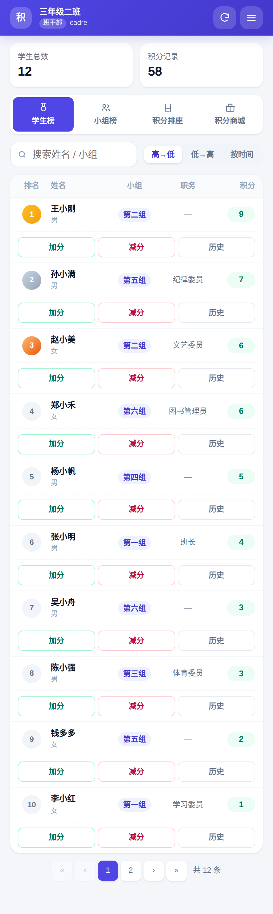
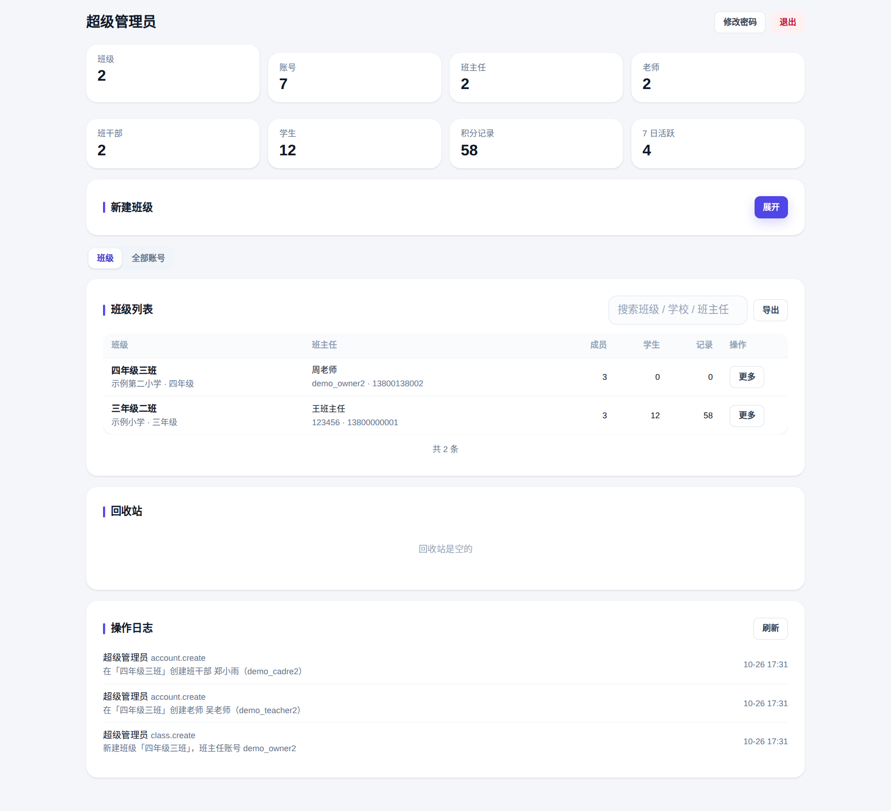

# 班级积分管理 · Class Points

一个面向小学班主任的班级积分管理系统：**花名册导入 / 实时加减分 / 积分排行 / 积分排座 / 积分商城 / 成绩分析与学习建议**，配套 **超级管理员 · 班主任 · 老师 · 班干部** 四级角色权限。

v2.1 新增三大能力：

- **学生档案**：学号、出生日期、家庭住址、家长姓名 / 手机号 / 关系 / 备用电话、备注，随花名册 Excel 自动识别导入，一键导出完整档案 Excel；
- **数据备份与恢复**：班级级 / 平台级 JSON 全量备份一键导出、上传即恢复（备份不含密码，密码一律重置后下发）；
- **全量操作日志 + 成绩对外查询**：谁在哪个班对谁做了什么、改了哪几个字段、失败了几次，全部可查可导出；家长凭「口令 + 学号」在公开页面免登录查成绩。

整套系统可完全私有部署：一个 Node.js 进程 + 一个 SQLite 文件，无需任何第三方云服务；线上版本托管在 EdgeOne Pages（静态前端 + Node 云函数 + Blob 数据存储），域名 <https://bj.5166966.xyz>。

<p>



</p>
<p>



</p>
<p>

</p>

> 以上截图使用 **虚构演示数据**（示例学校、化名学生、138xxxx 测试手机号），由仓库内 `scripts/seed-demo.js` 生成，可复现。

---

## 特性

### 四级角色，边界清晰

| 能力 | 超级管理员 | 班主任 | 老师 | 班干部 |
| --- | :-: | :-: | :-: | :-: |
| 定位 | 平台运维：管人、管号、管归属 | 班级第一责任人 | 任课老师 | 学生干部 |
| 学生 | — | 增 / 改 / 删 | 增 / 改 | 只读 |
| 加减分 | — | 单人 + 批量 | 单人 + 批量 | 单人（单次 ≤5、每日 ≤20，可调） |
| 积分记录 | — | 查看 / 删除 / 清空 | 查看 / 导出 | 查看 |
| 排座 | — | 全权 | 全权 | 只读 |
| 积分商城 | — | 礼物增删 + 兑换 | 仅兑换 | 只读 |
| 成绩 | — | 导入 + 删除考试 | 导入 | — |
| 班级资料 / 清空数据 | — | ✓ | ✗ | ✗ |
| 成员账号 | 任意班级任意角色 | 本班老师 / 班干部 | ✗ | ✗ |
| 手机号 | 全量可见可改 | 仅脱敏 | 仅自己 | 仅自己 |

设计要点：

1. **超管不碰业务数据**——只负责建班、建号、改归属、重置密码、看手机号，避免平台方误改教学数据；超管动作全部落 `admin_audit`。
2. **删除权只给班主任**——老师能日常操作但删不了学生、清不了数据；所有"清空"先写回收站快照，超管可一键还原。
3. **班干部限额是硬约束**——防止学生互刷分，每次操作在流水里记 `operator_name / operator_role`，谁加的一目了然。

权限不是前端藏按钮：能力表在 `server/src/core/policy.js`，路由用 `requireCap('student:delete')` 声明，服务层再用登录态里的 `class_id` 校验归属。

### 班级端

- **学生榜**：排名（前三名金/银/铜）、小组、职务、积分；高→低 / 低→高 / 按时间（本期、本周、本月）；搜索、分页
- **加减分**：单人加分/减分、快捷规则一键填入、原因备注；班干部受额度限制
- **批量加减**：按学生 / 按小组、全选、统一原因
- **学生管理**：新增（含完整档案）、Excel/CSV 批量导入（自动识别「学号/学籍号/编号、出生日期/生日、家庭住址/住址、家长姓名/监护人、家长电话/家长联系方式/家长手机、与学生关系/关系、备用电话、备注」等同义表头，重复自动跳过）、完整档案模板下载、**档案 Excel 导出**（花名册 + 积分快照 + 班级信息三个 Sheet）、编辑（含家长联系方式）、删除、单人历史
- **快捷规则**：规则增删、Excel 导入、模板、恢复默认
- **小组榜**：总积分 / 人均 / 人数，支持按时间
- **积分排座**：可调布局、老师/学生视角、按积分/蛇形/随机、点座换人、整组对调、打印、导出
- **积分商城**：礼物增删、按学生/小组批量兑换、积分校验、库存、兑换记录导出
- **积分记录**：时段筛选、按学生搜索、分页、导出、单条删除（自动反向修正积分）、清空
- **成绩**：Excel 导入、考试切换与删除、学生个人（趋势图 + 学习建议）、小组成绩、班级成绩（均分/及格率/优秀率/分数段）
- **成员管理**：班主任创建账号、重置密码、停用、移除、转移班主任、设置班干部额度

### 超级管理员

- 平台看板：班级数、账号数（按角色拆分）、学生数、积分记录、7 日活跃
- 班级管理：新建班级（同时建班主任）、改名/学校/年级、班干部额度、删除（回收站）、恢复
- 账号管理：全量列表（姓名/角色/账号/手机号/班级/最后登录）、搜索筛选、新建、改姓名/手机号/登录名/状态、**改归属班级**、重置密码、删除
- 角色调整：把某人设为班主任时自动把原班主任降为老师，保证"一班一主"
- 回收站：已删除班级恢复、班级数据快照恢复
- 操作日志：建班/建号/改密/转移/删除/恢复全部可追溯
- **全量操作日志**：全部角色、全部模块（班级业务 / 成员 / 超管 / 登录 / 备份 / 对外查询）的每一步写操作，含操作者、角色、班级、目标、摘要、数量、成功或失败、状态码、IP、UA；编辑类操作记录**变更前后快照与字段级 diff**（点任意一行查看详情）；支持按时间 / 班级 / 角色 / 模块 / 结果 / 关键词筛选，导出 CSV，一键清理 N 天前旧日志
- **数据备份**：班级备份（班级资料 + 成员 + 学生档案 + 积分 + 规则 + 礼物 + 兑换 + 考试成绩 + 座位表）、平台全量备份（全部班级 + 全部账号 + 回收站 + 最近 2 万条日志）；上传 JSON 一键恢复为新班级或覆盖现有班级，失败整体回滚；**备份不含任何密码散列**
- **成绩对外查询**：为班级生成查询口令（可设有效期、可随时停用），家长打开 `/query.html` 输入口令 + 姓名学号即可免登录查看本人成绩、班均、最高分、班排与积分排名；一个口令只能查到命中的一名学生，家长手机号脱敏展示，失败尝试全部记入操作日志；另设**全局总开关**，超管可一键关闭（登录页入口隐藏、公开查询页不可访问），教师端完全不受影响

---

## 重要操作方法（速查）

### 学生档案与 Excel 导入导出（班主任）

1. **逐个录入**：首页右侧「新增学生（含档案）」→ 填姓名、学号、出生日期、家长姓名 / 手机号 / 关系、备用电话、住址、备注 → 添加。
2. **批量导入**：「批量导入」→ 选择 Excel/CSV → 导入。表头只要含「姓名」即可，其余列按同义表头自动识别（如「家长联系方式」会自动映射到家长手机号）。
3. **模板**：点「模板」下载 12 列完整档案模板，按列填好后导入。
4. **导出**：点「导出学生档案 Excel」，得到「花名册 + 积分快照 + 班级信息」三个 Sheet 的完整档案。
5. **编辑**：学生榜 → 「编辑」→ 弹窗内可修改全部档案字段（含家长联系方式）。

### 数据备份与恢复（超级管理员 → 数据备份页签）

1. **导出班级备份**：选择班级 → 「导出班级备份」，得到 JSON 文件（含该班全部数据）。
2. **导出平台全量备份**：一键下载所有班级 + 全部账号 + 回收站 + 操作日志。
3. **恢复**：上传备份 JSON（或直接粘贴内容）→ 选「恢复为新班级」或「覆盖现有班级」→ 开始导入。覆盖模式会先二次确认，导入失败整体回滚，不会留下半份数据。
4. ⚠️ **备份文件不包含登录密码**。恢复出的账号需要超管在「全部账号」里重置密码后才能登录。

### 成绩对外查询（超级管理员 → 成绩查询页签）

0. **总开关**：页签顶部「成绩自助查询 · 总开关」，默认**开启**。关闭后：登录页不再显示查询入口、家长公开查询页也无法访问（接口返回「功能已关闭」）；教师端与班级工作台完全不受影响，已生成的口令原样保留，重新开启即恢复。
1. 选择班级、填写用途备注、选查询范围（仅成绩 / 仅积分 / 成绩+积分）与校验方式（姓名+学号 / 姓名+家长手机后 4 位 / 仅姓名）、有效期 → 「生成口令」。
2. 弹窗里复制**查询入口链接**（`https://你的域名/query.html?token=口令`）发给家长。
3. 家长打开链接，输入学生姓名 + 学号（或手机尾号）即可看到本人成绩、班排、班均、积分与排名，全程免登录。
4. 口令可随时「停用 / 启用 / 删除」，停用后家长的链接立即失效；前提是学生档案里已填学号（或家长手机号）。
5. 建议校验方式选「姓名 + 学号」，防同班同名误查；每次查询（含失败尝试）都会记入操作日志。

### 全量操作日志（超级管理员 → 操作日志页签）

- 按时间（今天 / 近 7 天 / 近 30 天 / 全部）+ 班级 + 角色 + 模块 + 成败 + 关键词任意组合筛选；
- 点击任意一行查看详情：操作者、IP、UA、请求明细，编辑类操作还有**变更前后快照与字段级对比**（旧值划线 → 新值加粗）；
- 「导出 CSV」导出当前筛选结果（最多 1 万条）；「清理旧日志」按天数删除并需确认，清理动作本身也会被记录。

---

## 技术栈

| 层 | 选型 | 说明 |
| --- | --- | --- |
| 运行时 | Node.js 18+ | 无构建步骤，开箱即跑 |
| Web | Express 5 | 分层：routes → controller → service → repository |
| 数据 | SQLite（[sql.js](https://sql.js.org/) WASM） | 纯 JS，无需编译原生模块，Windows/macOS/Linux 一致 |
| 鉴权 | JWT + 服务端刷新令牌 | httpOnly Cookie，刷新即轮换，前端拿不到令牌 |
| 校验 | Zod | 所有入参在边界处收敛 |
| 前端 | 原生 ES Module + 手写 CSS | 无框架、无打包器，`public/` 直接托管 |
| 导出 | SheetJS（xlsx） | 花名册/成绩导入，CSV 导出带 BOM |

```
┌────────────────────────── 浏览器（public/） ──────────────────────────┐
│  index.html  ·  app.css（设计系统）  ·  js/{api,ui,store,...}.js       │
│  api.js：fetch 封装 + CSRF 头 + 401 自动刷新重试 + 文件下载             │
└──────────────────────────────┬───────────────────────────────────────┘
                               │  /api/*（httpOnly Cookie）
┌──────────────────────────────▼───────────────────────────────────────┐
│ Express 5                                                            │
│  middleware: requestContext(requestId/日志) → auth(requireCap) → 错误  │
│  modules: auth · class · members · super · public                    │
│    controller（解析/响应） → service（业务+事务） → repository（SQL）    │
└──────────────────────────────┬───────────────────────────────────────┘
                               │
                    SQLite（data/banjifen.sqlite，原子落盘）
```

---

## 快速开始

```bash
npm install
cp .env.example .env      # 默认值即可本地跑通
npm start                 # → http://localhost:3000
```

Windows 可直接双击 `start.bat`，macOS/Linux 用 `./start.sh`。

首次启动自动建表并写入演示数据：

| 角色 | 账号 | 密码 |
| --- | --- | --- |
| 超级管理员 | `admin` | `admin123456` |
| 班主任 | `123456` | `123456` |
| 老师 | `teacher` | `123456` |
| 班干部 | `cadre` | `123456` |

生成更完整的演示数据（12 名学生、58 条流水、两场考试、排座、兑换记录，用于复现 README 截图）：

```bash
npm start                    # 另开一个终端
node scripts/seed-demo.js
```

> 生产环境请修改 `.env` 中的 `JWT_SECRET`、`SUPER_PASSWORD`，并在首次登录后立即改密码。
> 本版数据结构（v2，含角色与班级归属）与早期"一个账号即一个班级"的结构不兼容，旧 `data/banjifen.sqlite` 需删除重建，启动时会明确提示。

---

## 目录结构

```
.
├─ server/
│  ├─ src/
│  │  ├─ index.js              # 启动：初始化 DB → 种子 → 监听 → 优雅停机
│  │  ├─ app.js                # 安全头、请求上下文、路由、错误处理
│  │  ├─ config.js             # 环境变量集中校验（缺失/非法即启动失败）
│  │  ├─ seed.js               # 种子：超管 + 演示班级 + 三种角色账号
│  │  ├─ core/
│  │  │  ├─ policy.js          # ★ 权限单一来源：角色 × 能力矩阵
│  │  │  ├─ errors.js          # 类型化错误体系
│  │  │  ├─ logger.js          # 结构化 JSON 日志（敏感字段脱敏）
│  │  │  ├─ security.js        # bcrypt / JWT / Cookie / 随机令牌
│  │  │  ├─ validation.js      # zod schema 集合
│  │  │  └─ excel.js           # xlsx 读写、CSV(BOM)、表头容错
│  │  ├─ db/
│  │  │  ├─ index.js           # sql.js 连接、事务、原子落盘、迁移、旧库自检
│  │  │  └─ migrations/001_init.sql
│  │  ├─ middleware/           # requestContext · auth · error · rateLimit
│  │  └─ modules/
│  │     ├─ auth/              # 双入口登录、刷新、改密
│  │     ├─ class/             # 学生、积分、规则、商城、排座、成绩
│  │     ├─ members/           # 班主任管理本班成员
│  │     ├─ super/             # 超管：班级、账号、归属、回收站、审计
│  │     └─ public/            # 版本号、健康检查
│  └─ test/smoke.test.js       # 74 项集成测试
├─ public/
│  ├─ index.html               # 班级工作台
│  ├─ login.html               # 独立登录页
│  ├─ settings.html            # 独立设置页
│  ├─ query.html               # 家长免登录成绩查询页
│  ├─ css/design-system.css    # 设计系统 v2（4pt 间距 + 统一列模板 + tabular-nums）
│  └─ js/
│     ├─ api.js ui.js store.js app.js
│     ├─ class-app.js class-mall.js class-seat.js class-scores.js
│     ├─ members.js            # 成员管理
│     ├─ super-app.js          # 超级管理员（含日志/备份/查询页签）
│     └─ query.js              # 公开查询页逻辑
├─ scripts/seed-demo.js        # 虚构演示数据（README 截图来源）
├─ docs/screenshots/           # 界面截图（虚构数据）
├─ data/                       # 运行后生成，已 gitignore
└─ .env.example
```

---

## API

统一前缀 `/api`；写操作需带 `x-requested-with: fetch`（CSRF）；错误统一 `{ error: { code, message }, requestId }`。

| 分组 | 端点 |
| --- | --- |
| 认证 | `POST /auth/login`（`entry: class\|super`）、`POST /auth/refresh`、`POST /auth/logout`、`GET /auth/me`、`POST /auth/password` |
| 班级 | `GET /class/overview`、`PUT /class/profile`、`GET\|POST /class/students`、`PATCH\|DELETE /class/students/:id`、`POST /class/students/import`、`GET /class/students/template`、`DELETE /class/students/:id/logs`、`GET /class/groups` |
| 积分 | `POST /class/points`、`GET\|DELETE /class/logs`、`DELETE /class/logs/:id`、`GET /class/logs/export.csv`、`GET /class/ranking/export.csv`、`POST /class/reset-points`、`POST /class/clear-all` |
| 规则 / 商城 | `GET\|POST /class/rules`、`DELETE /class/rules/:id`、`POST /class/rules/reset\|import`、`GET\|POST /class/gifts`、`PATCH\|DELETE /class/gifts/:id`、`POST /class/gifts/:id/redeem`、`GET /class/redemptions(+/export.csv)` |
| 排座 / 成绩 | `GET\|PUT /class/seat`、`POST /class/seat/auto`、`GET /class/exams`、`POST /class/exams/import`、`DELETE /class/exams/:id`、`GET /class/scores`、`GET /class/scores/student/:id` |
| 成员 | `GET\|POST /members`、`PATCH\|DELETE /members/:id`、`POST /members/transfer-owner`、`PATCH /members/settings/limits` |
| 超管 | `GET /super/overview`、`GET\|POST /super/classes`、`PATCH\|DELETE /super/classes/:id`、`POST /super/classes/:id/restore\|transfer-owner`、`GET /super/classes/export.csv`、`GET\|POST /super/accounts`、`PATCH\|DELETE /super/accounts/:id`、`POST /super/accounts/:id/reset-password`、`GET /super/recycle`、`POST /super/recycle/:id/restore`、`GET /super/audit` |
| 操作日志 | `GET /super/logs`（时间/班级/角色/模块/结果/关键词筛选）、`GET /super/logs/export.csv`、`POST /super/logs/clear` |
| 备份 | `GET /super/backup/class/:id`、`GET /super/backup/platform`、`POST /super/backup/import`（multipart `file` 或 `text`，`mode=create\|replace`） |
| 对外查询 | `GET\|POST /super/query-tokens`（生成 / 列表）、`PATCH\|DELETE /super/query-tokens/:id`（启停 / 删除）、`GET\|POST /public/query/:token`（免登录，限流 60 次/分）、`GET\|POST /super/settings/public-query`（查询总开关，默认开启） |
| 学生档案 | `GET /class/students/export.xlsx`（档案三 Sheet 导出）；`POST\|PATCH /class/students` 支持 `studentNo/birthday/address/guardianName/guardianPhone/guardianRelation/guardianAltPhone/note` |
| 公开 | `GET /public/settings`、`GET /health`、`GET /ready` |

---

## 数据模型

| 表 | 说明 |
| --- | --- |
| `classes` | 班级（= 数据空间）：名称、学校、年级、徽章、`owner_id`、班干部额度 |
| `accounts` | 账号：`role` = super_admin / owner / teacher / cadre，`class_id` 归属，`phone`，软删除 |
| `auth_sessions` | 刷新令牌（只存 SHA-256），支持轮换与吊销 |
| `students` | 学生：姓名、小组、性别、职务、当前积分 + 档案（`student_no`、`birthday`、`address`、`guardian_name/phone/relation/alt_phone`、`note`），软删除 |
| `point_logs` | 积分流水：分值、原因、类型、`operator_id / operator_name / operator_role` |
| `quick_rules` / `gifts` / `redemptions` | 快捷规则、礼物、兑换记录 |
| `exams` / `scores` | 考试与成绩（`exam_id + student_id` 唯一） |
| `seat_plans` | 排座布局与座位 JSON |
| `recycle` | 清空/删除前快照，超管可恢复 |
| `admin_audit` | 超管操作审计（旧表，与 operation_logs 双写） |
| `operation_logs` | **全量操作日志**：操作者（id/姓名/角色）、班级、模块、动作、目标、摘要、数量、成败、状态码、detail（含 BEFORE/AFTER 快照）、IP、UA |
| `query_tokens` | **对外查询口令**：班级、口令（唯一）、范围、校验方式、启停、有效期、创建人、最近使用时间 |
| `platform_settings` | **全局平台设置**（键值对）：如 `public_query_enabled`（成绩自助查询总开关，缺省开启） |

所有业务查询以 `class_id` 为边界（来自登录态，不接受前端传入）；越权访问统一 403/404。

---

## 界面规范（视觉对齐）

设计系统写在 `public/css/app.css` 顶部，四条硬规则：

1. **间距只用 4pt 刻度**（4/8/12/16/24/32/48），不出现一次性数值；卡片内边距统一 `--pad-card`，页面左右统一 `--gutter`。
2. **表格共用一套列模板**：`--cols-student / --cols-group / --cols-score` 同时作用于表头与数据行，保证纵向严格同列；只在断点处重定义，不在行内微调。
3. **数字右对齐 + `tabular-nums`**：积分、人数、均分、日期一律等宽数字并右对齐；文本左对齐。
4. **层级靠有限刻度**：圆角 8/12/16/20，阴影 3 档，z-index 语义化（sticky → dropdown → backdrop → modal → toast）。

配套的克制原则：操作按钮描边不实心（只有加减分出色）、空状态一句话、卡片不嵌套、图标统一线性 SVG（不依赖 emoji 字体）。

---

## 成绩「学习建议」是怎么算的

不是调用大模型，而是可复现的规则算法（`server/src/modules/class/class.service.js` → `studentScoreDetail()`）：

```js
const avg   = 历次平均分;             // 水平判断
const delta = 最近一次 - 最早一次;     // 趋势判断
```

1. **水平**：`≥85` 班级前列 / `70–85` 中等偏上 / `<70` 基础需加强
2. **趋势**：`Δ ≥ +5` 上升 / `Δ ≤ -5` 下滑 / 其余平稳
3. **建议模板**按水平三选一（保持节奏挑战拓展 / 专项练习 + 错题归类 / 基础题 + 每日一练 + 家长配合）
4. 拼接：`平均分 X 分，{水平}；最近一次 Y 分，{趋势}（较首次 ±Z 分）。{建议}`

结果稳定、可解释、离线零成本；想换成 AI 评语只需替换这一处，接口结构 `{ trend, advice }` 不变。

---

## 测试

```bash
npm test
```

拉起独立实例（临时数据库 + 独立端口），覆盖：

- 三角色 + 超管登录与能力清单
- 权限边界：班干部额度/批量/删除/清空 403，老师不能删除与清空
- 学生与花名册导入、加减分与流水回滚、CSV 导出
- 商城兑换（积分不足校验）、排座、成绩三视图与学习建议
- 成员管理：建号、改密、停用、转移班主任、额度调整
- 超管：建班、建号、改密、改手机号、改归属、"一班一主"、删除恢复、快照恢复、审计、导出
- **学生档案**：档案写入/编辑、电话校验、档案 Excel 导出
- **审计 / 备份 / 对外查询**：操作日志落库与筛选、CSV 导出、失败记录、日志清理；班级与平台备份导出（不含密码）、导入恢复、非法备份拒绝；查询口令生成、免登录查询与号码脱敏、学号不匹配拒绝、停用即失效
- 安全：CSRF、422、越权 404、登出失效、刷新令牌

```
结果：通过 74，失败 0
```

---

## 部署

### 方式一：EdgeOne Pages（零成本，推荐）

无需服务器、无需证书运维，静态前端 + Node 云函数 + Blob 数据存储全部由 EdgeOne 免费套餐承载：

1. **GitHub 直连**（推荐）：在 EdgeOne Pages 控制台导入 `Yellowsoy/banjifen` 私有仓库，构建配置：
   - 安装命令 `npm install`
   - 构建命令 `node scripts/gen-inline.js && node scripts/build-edgeone.js`
   - 输出目录 `deploy/edgeone-dist`，Node 22
   - 之后每次 `git push` 自动构建上线。
2. **CLI 直传**：`EDGEONE_TOKEN=<Pages API Token> npm run deploy:edgeone`
3. **自定义域名**：控制台绑定域名后，在域名 DNS 处加 CNAME 到 EdgeOne 分配的目标（形如 `<域名>.pages.dnsoe6.com`），按提示加 `_dnsauth` 验证记录，免费证书自动签发（约几分钟到半小时）。

架构说明：云函数把 `/api/*` 交给 `cloud-functions/api/[[default]].js`（打包后的 Express 应用），数据整库快照持久化在 Pages Blob（强一致读 + 每次写后落盘 + 多实例版本同步），wasm 与迁移 SQL 已内联进构建产物，无需本地文件系统。

> 多实例说明：Blob 为「读己之写 + 快照版本同步」，同一班级低并发使用完全够用；极端并发下写入为最后写入胜出。

### 方式二：自有服务器

```bash
# 1. 常驻
npm i -g pm2
pm2 start server/src/index.js --name banjifen
pm2 save

# 2. Nginx 反代（示例）
server {
  listen 443 ssl http2;
  server_name your.domain.com;
  client_max_body_size 8m;

  ssl_certificate     /etc/letsencrypt/live/your.domain.com/fullchain.pem;
  ssl_certificate_key /etc/letsencrypt/live/your.domain.com/privkey.pem;

  location / {
    proxy_pass http://127.0.0.1:3000;
    proxy_set_header Host $host;
    proxy_set_header X-Real-IP $remote_addr;
    proxy_set_header X-Forwarded-For $proxy_add_x_forwarded_for;
    proxy_set_header X-Forwarded-Proto $scheme;
  }
}
```

生产清单：`NODE_ENV=production`、强随机 `JWT_SECRET`、HTTPS（Cookie 自动加 `secure` 并启用 HSTS）、定期备份 `data/banjifen.sqlite`。

> SQLite 以 sql.js 载入内存、写入后原子落盘，单校规模（万级学生、十万级流水）足够。若要多实例横向扩展，把 `server/src/db/index.js` 换成 PostgreSQL 驱动即可，上层仓储调用方式不变。

---

## 安全设计

- **密码**：bcrypt（cost 10）；超管重置密码后强制该账号所有会话失效
- **令牌**：访问令牌 30 分钟 + 刷新令牌 14 天（服务端存哈希、刷新即轮换），全部 httpOnly Cookie，不落 localStorage
- **CSRF**：`SameSite=Lax` + 非 GET 强制自定义头
- **越权**：`requireAuth(role)` → `requireCap(capability)` → 服务层 `class_id` 归属校验；超管接口独立命名空间 `/api/super`
- **隐私**：手机号仅超管见全量，班主任见脱敏值；日志脱敏敏感字段
- **限流**：登录 5 分钟 30 次（内存窗口，多实例建议换 Redis）
- **审计**：全站写操作统一经 `trail()` 中间件落 `operation_logs`（含失败请求），敏感字段（密码/令牌）自动脱敏，编辑操作留前后快照
- **对外查询**：公开接口仅暴露命中学生的本人数据，家长手机号一律脱敏，口令可随时吊销，限流 60 次/分；另有全局总开关，关闭后公开查询接口直接拒绝（默认开启）
- **数据**：多步写入事务；SQLite 以临时文件 + rename 原子落盘，退出前 flush

---

## 说明

- 界面与业务流程参考了公开的班级积分类产品形态后**重写实现**，代码为本项目自有实现；不含任何第三方站点的私有代码或用户数据。
- README 截图均使用 `scripts/seed-demo.js` 生成的**虚构数据**（示例学校、化名、测试号段手机号）。
- 如需商用或二次分发，请自行确认所用第三方库（Express / SheetJS 等）的许可条款。
